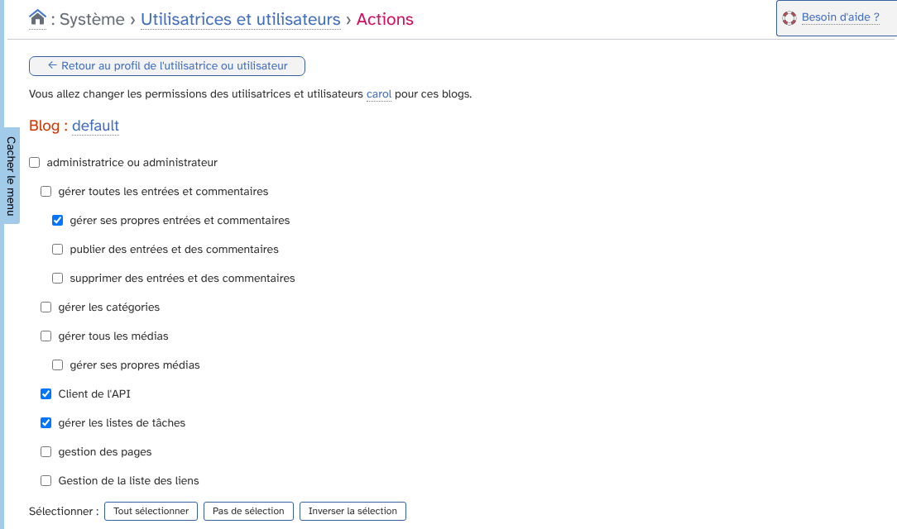
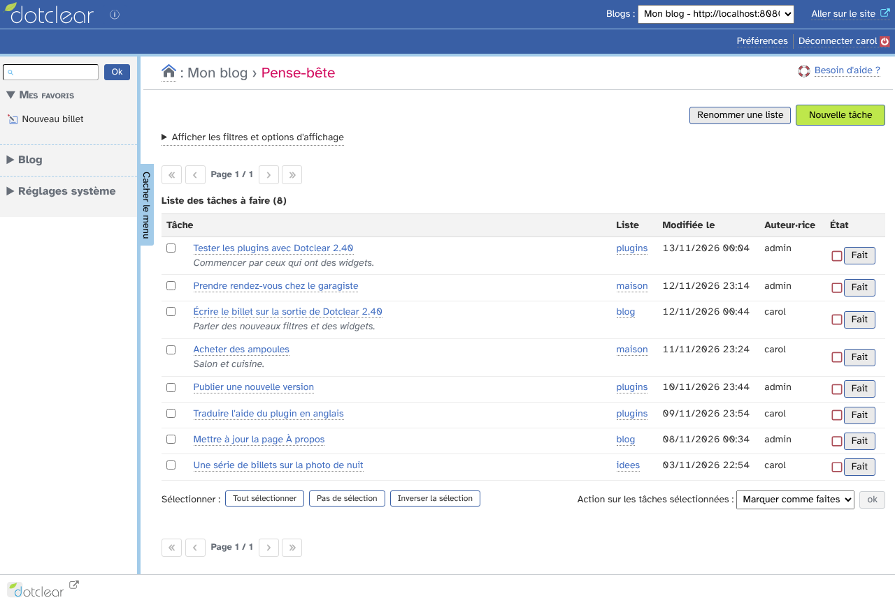
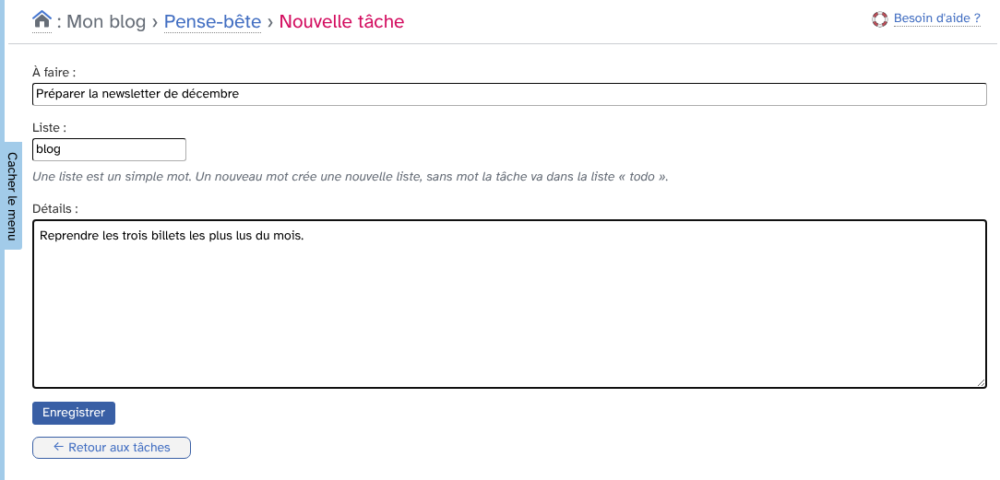
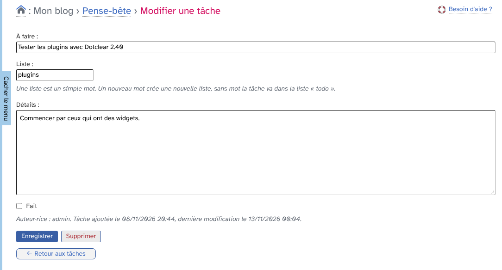
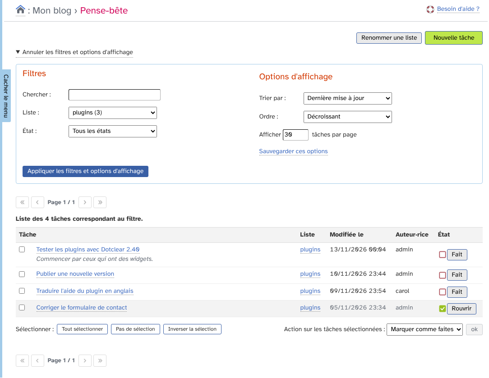
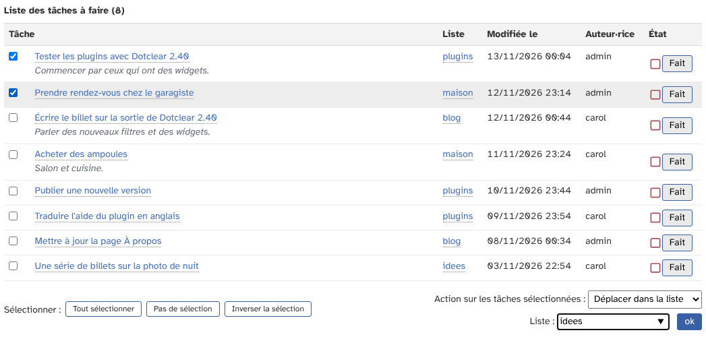
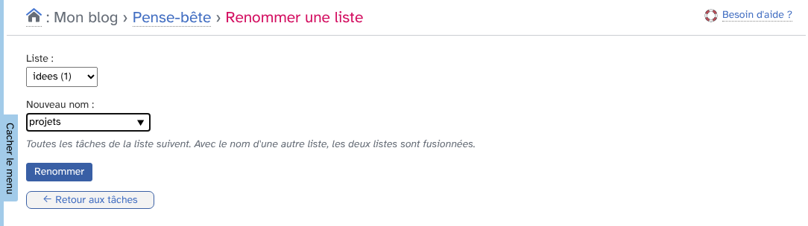
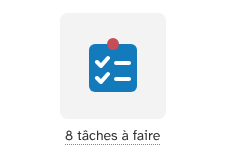
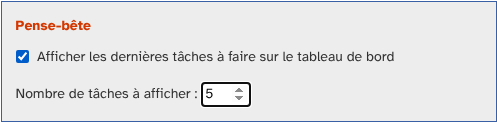
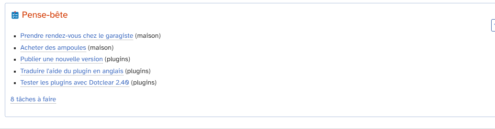

# Pense-bête : guide d'utilisation

_PenseBete_ (« Pense-bête » dans l'administration en français) est un plugin pour [Dotclear](https://dotclear.org)
qui ajoute des listes de choses à faire à l'administration d'un blog.

Les tâches appartiennent au blog : elles sont partagées par toutes les personnes du blog qui ont le droit
de s'en servir. Rien n'apparaît sur la partie publique du blog.

* [Installation et permissions](#installation-et-permissions)
* [Tâches et listes](#tâches-et-listes)
* [La page du plugin](#la-page-du-plugin)
* [Ajouter une tâche](#ajouter-une-tâche)
* [Modifier, terminer ou supprimer une tâche](#modifier-terminer-ou-supprimer-une-tâche)
* [Filtrer et trier](#filtrer-et-trier)
* [Agir sur plusieurs tâches](#agir-sur-plusieurs-tâches)
* [Renommer ou fusionner des listes](#renommer-ou-fusionner-des-listes)
* [Le tableau de bord](#le-tableau-de-bord)
* [Avec un assistant IA](#avec-un-assistant-ia)
* [Désinstallation](#désinstallation)

## Installation et permissions

Le plugin demande Dotclear 2.40 et PHP 8.3 ou plus récent. Installez-le comme n'importe quel plugin, depuis la
page _Plugins_ de l'administration.

Les administrateurs du blog y ont accès d'office. Pour les autres personnes, donnez la permission
**« gérer les listes de tâches »** sur le blog voulu, depuis _Système › Utilisatrices et utilisateurs ›
Permissions_.

Le plugin apparaît alors dans le menu _Blog_, sous le nom **Pense-bête**.

## Tâches et listes

Une **tâche** tient en une ligne (255 caractères au plus). Elle peut avoir des **détails**, sur plusieurs lignes,
si le titre ne suffit pas. Une tâche est soit **à faire**, soit **faite**. Les tâches faites restent
dans le pense-bête jusqu'à ce que quelqu'un les supprime.

Une **liste** est désignée par un seul mot : des lettres, des chiffres, `-` ou `_`, sans espace. Elle est
enregistrée en minuscules, donc `Plugins` et `plugins` sont la même liste. Il n'y a rien à créer à l'avance :

* une liste naît avec sa première tâche,
* elle disparaît avec sa dernière tâche,
* une tâche ajoutée sans liste va dans la liste `todo`.

Chaque tâche garde le nom de la personne qui l'a ajoutée, sa date d'ajout et la date de sa dernière modification.

## La page du plugin

La page du plugin affiche les tâches à faire du blog, les dernières modifiées en premier.

* Le titre de chaque tâche mène à sa page de modification, et le nom de sa liste affiche toutes les tâches de cette liste.
* Les détails sont affichés sous le titre.
* Le bouton **Fait** de la colonne _État_ marque tout de suite la tâche comme faite. Sur une tâche faite,
  le bouton **Rouvrir** la remet à faire.
* Le bouton vert **Nouvelle tâche**, en haut à droite, ouvre le formulaire d'ajout.
* Le bouton **Renommer une liste** ouvre le formulaire de renommage.

## Ajouter une tâche

Renseignez ce qu'il y a à faire, et si besoin le nom de la liste et des détails, puis enregistrez.
Le champ _Liste_ propose les listes existantes au fil de la frappe. Un nouveau mot crée une nouvelle liste.

Si la page des tâches était filtrée sur une liste, le formulaire d'ajout est déjà rempli avec cette liste.

## Modifier, terminer ou supprimer une tâche

Un clic sur le titre d'une tâche ouvre sa page.

On peut y changer le titre, la liste et les détails. La case **Fait** marque la tâche comme faite ou la remet
à faire. En bas de page sont indiqués la personne qui a ajouté la tâche, la date de son ajout et celle de sa
dernière modification.

Le bouton **Supprimer** efface la tâche après confirmation. La suppression est définitive : pour garder une
trace, marquez plutôt la tâche comme faite.

## Filtrer et trier

Le lien **Afficher les filtres et options d'affichage**, en haut de la liste, déplie le même bloc de filtres
que les autres listes de Dotclear (billets, commentaires…).

Filtres :

* **Chercher** : un mot ou un bout de phrase, cherché dans les titres et les détails, sans tenir compte
  des majuscules ni des accents (« cafe » trouve « Café »).
* **Liste** : une seule liste, avec entre parenthèses son nombre de tâches.
* **État** : _À faire_ (par défaut), _Fait_ ou _Tous les états_.

Options d'affichage :

* **Trier par** : dernière mise à jour, date de création, titre de la tâche ou liste, dans l'ordre croissant
  ou décroissant.
* **Afficher _n_ tâches par page** : 30 par défaut.

Le lien **Sauvegarder ces options** garde le tri et le nombre de tâches par page pour vos prochaines visites.
Ils peuvent aussi être réglés dans vos préférences, onglet _Mes options_, avec ceux des autres listes de Dotclear.

## Agir sur plusieurs tâches

Cochez des tâches, puis choisissez une action en bas de la liste :

* **Marquer comme faites**,
* **Remettre à faire**,
* **Déplacer dans la liste** : un champ _Liste_ apparaît pour saisir la liste de destination, existante ou nouvelle,
* **Supprimer**, après confirmation.

Les boutons _Tout sélectionner_, _Pas de sélection_ et _Inverser la sélection_ aident à cocher les tâches.
Les filtres en cours sont conservés après l'action.

## Renommer ou fusionner des listes

Le bouton **Renommer une liste**, en haut de la page du plugin, ouvre un formulaire à part.

Choisissez la liste, saisissez son nouveau nom, puis cliquez sur **Renommer** : toutes les tâches de la liste
suivent, qu'elles soient à faire ou faites. Si le nouveau nom est celui d'une liste existante, les deux listes
sont fusionnées.

## Le tableau de bord

Deux éléments peuvent être ajoutés au tableau de bord. Chaque personne les règle pour elle-même dans
ses **Préférences**, onglet _Mon tableau de bord_.

### L'icône avec le nombre de tâches à faire

Dans _Autres favoris disponibles_, cochez **Pense-bête**, puis cliquez sur _Ajouter à mes favoris_.

Le favori apparaît dans le menu et sous forme d'icône sur le tableau de bord. Sur le tableau de bord, son titre
donne le nombre de tâches à faire du blog. S'il n'y en a aucune, il affiche simplement « Pense-bête ».

### La liste des dernières tâches ajoutées

Plus bas dans le même onglet, après _Modules du tableau de bord_, le bloc **Pense-bête** propose :

* **Afficher les dernières tâches à faire sur le tableau de bord**, décoché par défaut,
* **Nombre de tâches à afficher** : 5 par défaut, 50 au plus.

Après enregistrement, le tableau de bord affiche les dernières tâches à faire ajoutées au blog, les plus récentes
en premier, avec le nom de leur liste. Chaque titre mène à la tâche, le lien du bas mène à la page du plugin.
Le bloc n'apparaît pas quand il ne reste rien à faire.

## Avec un assistant IA

Si le plugin [ClaudetteMcp](https://github.com/JcDenis/ClaudetteMcp) est installé sur le blog, un assistant IA
connecté au blog (Claude, par exemple) peut lire et compléter le pense-bête. On peut alors lui demander, en
langage naturel :

* « Ajoute à ma liste plugins de tester la nouvelle version »,
* « Qu'est-ce qu'il me reste à faire dans la liste maison ? »,
* « C'est fait pour le rendez-vous chez le garagiste. »

_PenseBete_ ajoute trois outils au connecteur :

| Outil | Rôle |
|---|---|
| `list_todos` | Lire les listes du blog et leurs tâches, par liste, état ou recherche |
| `add_todo` | Ajouter une tâche à une liste |
| `update_todo` | Marquer une tâche comme faite ou à faire, changer son titre ou ses détails, la déplacer dans une autre liste |

Quelques règles :

* L'assistant agit avec les droits de l'utilisateur de la clé de connexion, qui doit avoir la permission
  « gérer les listes de tâches ».
* Avec une clé en lecture seule, seul `list_todos` est disponible.
* Aucun outil ne supprime de tâche : si on lui demande d'en supprimer une, l'assistant la marque comme faite.
  La suppression se fait dans l'administration.
* Après l'installation ou la mise à jour de _PenseBete_, reconnectez le connecteur de l'assistant pour valider
  les nouveaux outils.

ClaudetteMcp n'est pas nécessaire au fonctionnement du plugin.

## Désinstallation

Avec le plugin _Uninstaller_ de Dotclear, la désinstallation propose de supprimer la table des tâches,
les préférences des utilisateurs liées au plugin (tableau de bord) et le plugin lui-même.
